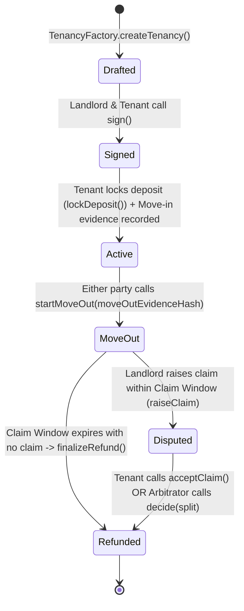

# TrustRent System Architecture

## 1. System Topology Overview

```mermaid
flowchart TB
    subgraph Users["End Users"]
        Tenant["Tenant (React Web)"]
        Landlord["Landlord (React Web)"]
        Arbitrator["Arbitrator (React Web)"]
    end

    subgraph AA["Account Abstraction & Auth"]
        SocialLogin["Social Login (Web3Auth/Biconomy)"]
        Paymaster["ERC-4337 Paymaster (Gasless)"]
        Bundler["ERC-4337 Bundler"]
    end

    subgraph OffChain["Backend & Off-Chain Storage"]
        API["FastAPI Python Backend (Async)"]
        Postgres[(PostgreSQL Metadata)]
        EncryptedStore["AES-256-GCM Encrypted Storage (IPFS / Local)"]
        Keeper["Autonomous Keeper Service"]
        MockID["Mock Identity Verifier"]
    end

    subgraph OnChain["Polygon Amoy EVM Blockchain"]
        MockINR["MockINR (ERC-20 Faucet Token)"]
        IDRegistry["IdentityRegistry"]
        ArbRegistry["ArbitratorRegistry"]
        Factory["TenancyFactory (Clones EIP-1167)"]
        Vault["DepositVault (Cloned per tenancy)"]
    end

    Tenant --> SocialLogin
    Landlord --> SocialLogin
    Arbitrator --> SocialLogin
    SocialLogin --> API
    SocialLogin --> Bundler
    Bundler --> Paymaster --> OnChain

    API --> Postgres
    API --> EncryptedStore
    API --> MockID
    MockID -->|Attest on-chain| IDRegistry

    Keeper -->|sponsor finalizeRefund()| Vault
    Factory -->|deploys clone| Vault
    Vault -->|reads/locks| MockINR
```

---

## 2. Smart Contract State Machine

Each tenancy deployed by `TenancyFactory` has its own isolated `DepositVault` proxy (EIP-1167 lightweight minimal proxy).



### State Definitions & Enforced Invariants
| State | Value | Allowed Transitions | Invariant Rules |
|---|---|---|---|
| `Drafted` | 0 | `Signed` | Requires signature from both verified tenant & landlord addresses. |
| `Signed` | 1 | `Active` | Deposit must be locked (`MockINR.transferFrom`) and move-in hash submitted. |
| `Active` | 2 | `MoveOut` | Allowed once tenancy lease end date is reached or mutually initiated. |
| `MoveOut` | 3 | `Disputed`, `Refunded` | Landlord has `claimWindow` (e.g., 7 days) to file a claim. If window elapses, anyone/keeper can trigger full refund. |
| `Disputed` | 4 | `Refunded` | Claim amount <= `deductionCap` <= `depositAmount`. Arbitrator or tenant acceptance settles split. |
| `Refunded` | 5 | Terminal State | Vault funds transferred in full, balance = 0. |

---

## 3. Off-Chain Storage & Cryptographic Verifiability
1. **Hashing Scheme:**
   - Raw lease agreement and uploaded evidence files (images/PDFs) are hashed locally using `keccak256`.
   - File manifests bundle individual file hashes into a single root manifest hash submitted to the blockchain.
2. **Confidentiality:**
   - Files are encrypted via AES-256-GCM with a unique key per file before uploading to IPFS or local storage.
   - Keys are wrapped and guarded by the FastAPI backend, decryptable only by verified parties (Landlord, Tenant, Assigned Arbitrator).
3. **Verification Loop:**
   - Any party can download an encrypted file, decrypt it, recompute `keccak256(content)`, and compare it against the on-chain recorded hash. A match guarantees zero tampering.

---

## 4. Backend Architecture (FastAPI)
The backend follows a strict Clean Architecture / Layered pattern:
- **`routers/`**: HTTP Request/Response handling, Pydantic DTO validation, authentication dependencies (no direct DB/blockchain logic).
- **`services/`**: Business logic orchestration (`AuthService`, `IdentityService`, `TenancyService`, `EvidenceService`, `KeeperService`).
- **`repositories/`**: SQLAlchemy 2.0 async database queries and transactional boundaries.
- **`chain/`**: Web3.py client wrapper for reading on-chain events and submitting sponsored keeper transactions.
- **`storage/`**: `StorageProvider` abstraction with `LocalEncryptedStorageProvider` and `IPFSStorageProvider`.
